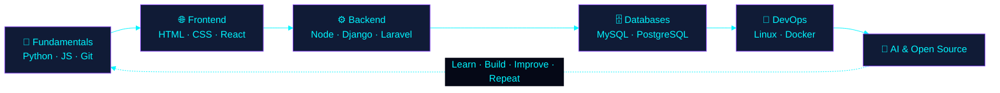

<div align="center">


<a href="https://github.com/Vidushasenal">
  
</a>

<br/>

<a href="https://github.com/Vidushasenal?tab=repositories">
  
</a>


</div>


## 👨‍💻 `whoami`

> [!NOTE]
> 👋 Hi, I'm **Vidusha Senal**, an IT & Technology student who learns by building.
> I turn ideas into working software, from the first line of code to a finished project.

<div align="center">


</div>

### 🧭 My Growth Path



<table>
  <tr>
    <td width="50%" valign="top">

### 🔭 What I'm doing
- 🛠️ Building web apps and software ideas
- 🧱 Exploring frontend, backend, databases and architecture
- 🎯 Solving real-world problems with code

</td>
    <td width="50%" valign="top">

### 🌱 What I'm exploring
- 🐍 Python & JavaScript in depth
- 🐧 Linux and the command line
- 🤖 AI and automation
- 🌍 Open-source contributions

</td>
  </tr>
</table>


## ⚡ Tech Arsenal

<div align="center">

**Languages**<br/>


**Frameworks & Runtimes**<br/>


**Web & CMS**<br/>


**Tools, Databases & Platforms**<br/>


</div>


## 📊 GitHub Performance

<div align="center">


<br/><br/>


<br/><br/>


</div>


## 🚀 Featured Projects

<!--
  TODO: Replace YOUR_PROJECT_1 / YOUR_PROJECT_2 with real public repo names,
  then remove the comment markers around this block.

<div align="center">

<a href="https://github.com/Vidushasenal/YOUR_PROJECT_1">
  
</a>
<a href="https://github.com/Vidushasenal/YOUR_PROJECT_2">
  
</a>

</div>
-->

📌 More of my work is on my [repositories page](https://github.com/Vidushasenal?tab=repositories).


## 🎯 Current Mission

```text
[▶] Mastering full-stack development
[▶] Building real-world software projects
[▶] Improving software design and architecture
[▶] Exploring AI and automation
[▶] Contributing to the developer community
```


## 🤝 Let's Connect

<div align="center">

<a href="https://github.com/Vidushasenal">
  
</a>
<!--
  TODO: add your real details, then remove these comment markers.
<a href="https://www.linkedin.com/in/YOUR_LINKEDIN_USERNAME/">
  
</a>
<a href="mailto:YOUR_EMAIL@example.com">
  
</a>
-->

<br/><br/>


<br/><br/>

*"Great software starts with curiosity and grows through consistency."*


</div>
